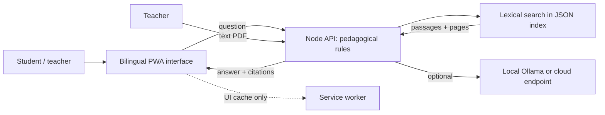

# Umuseke: a grounded AI tutor for Rwandan secondary school

A mobile-first, installable (PWA) web prototype, accompanied by a native Node API. The demonstration scope is **Mathematics, Senior 2 (S2)**, with answers supported by passages from the loaded documents and their pages.

> **Honest status of the deliverable.** The initial folder contained the brief and a design document, but no REB textbook or code. The API, interface and evaluation tools in this repository are a prototype created for this challenge. The evaluation data contains demonstration questions and is not trial results. No trial with students/teachers, public deployment, Kinyarwanda validation by a native speaker, GitHub/Hugging Face account, or textbook rights authorization is attested. Do not present these points as accomplished.

## Features present

- Responsive PWA web app with Study / Library / Progress / pilot-readiness navigation, English/Kinyarwanda interface, page-by-page passage reader and import of authorized PDFs.
- Readiness view that separates the prototype, evidence still to be gathered (3 people, 2 teachers, languages, red team, models) and safeguards not implemented.
- Native Node API: text PDF ingestion via `pdftotext`, page by page, lexical search, extracted answer and citations; refusal if no passage matches.
- Structured library of ten chapters under `data/documents/mathematics/s2/`, with JSON index, CSV formulas, equations, examples and tables. The demonstration content is explicitly marked **NOT REB**; no official Rwandan document is provided in this repository. The Rwandan context examples under `data/documents/rwanda/` are illustrative, not government data.
- Configurable generation provider via an OpenAI-compatible endpoint, including local Ollama; without a provider, an extractive path that does not claim to have solved the exercise.
- Offline: application shell and resources cached. Tutor answers require the network; the embedded model and SQLite indexing are not implemented.
- Local accounts by pseudonym: student registration, login/logout, teacher role protected by an invitation code, and administrator creation from the terminal. Passwords are hashed with scrypt; sessions expire after eight hours and are kept in memory.
- PDF import is restricted on the API side to the teacher and administrator roles. Assessment remains blocked: authentication alone does not yet provide teacher assignment or control of an assessment.
- PDF upload limited to 25 MB. Scans without a text layer are implicitly detected as pages without extraction; no OCR is integrated.

## Local start (about 5 minutes)

Prerequisites: Node.js 20+ and `pdftotext` (Poppler; required to extract PDFs).

The complete list of current and future dependencies is in [DEPENDENCIES.md](DEPENDENCIES.md).

```bash
npm start
```

Or run `./start.sh` directly. The server starts on port 8000 by default; change it with `PORT=8080 ./start.sh` if needed.

Open [http://127.0.0.1:8000](http://127.0.0.1:8000). No model is required to start. Once a text PDF is loaded in Library, the API answers from the retrieved passages. The initial content explains the flow; it does not display demonstration answers that could be mistaken for the textbook.

### Qwen or Llama (optional)

Install Ollama, download `qwen3:4b` once with `ollama pull qwen3:4b`, start Ollama, then run `./start-qwen.sh`. The model can be replaced, for example with `LLM_MODEL=llama3.2:1b ./start-qwen.sh`. See [AI_MODEL_SETUP.md](AI_MODEL_SETUP.md). No large model is downloaded automatically.

### Sharing and installing

- To share the code, send the project folder (without student PDFs or secrets). The recipient installs Node.js 20+, then runs `npm start` or `./start-8080.sh`.
- For a reproducible run with Docker: `docker build -t umuseke .` then `docker run --name umuseke --rm -p 127.0.0.1:8080:8080 -v umuseke-data:/var/lib/umuseke -e UMUSEKE_TEACHER_SIGNUP_CODE="$UMUSEKE_TEACHER_SIGNUP_CODE" umuseke`. Open `http://localhost:8080`. The container runs without root privileges. The volume keeps the accounts, uploaded PDFs and their index. The port is bound to localhost; do not replace this with public HTTP exposure.
- On `localhost`, Chrome/Edge allow installing the PWA from the "Install app" button. A remote installation requires an HTTPS address and accessible hosting; the local folder alone does not create a public link. For Internet access, place the container behind a maintained reverse proxy that provides TLS, restricts network access and applies backups. Never send `LLM_API_KEY` to the browser.
- Imported PDFs and generated indexes are local to the `data/` folder; back up this folder if these documents must be kept. The demonstration documents are already included.

#### Free demo on Render

The `render.yaml` file configures a free Docker Web Service with a health check. To launch it, place this project in a private or public GitHub repository that your Render account can access, then in Render choose **New → Blueprint**, connect this repository and apply the Blueprint. Render builds the image with the Dockerfile and provides an HTTPS URL. See the [official Blueprint reference](https://render.com/docs/blueprint-spec) and the [Docker reference](https://render.com/docs/docker).

The free tier is intended only for a demonstration: the service may go to sleep and its file system is not persistent. Accounts, sessions and imported PDFs may disappear on a restart or redeployment. No AI model is configured by default. Do not enter student data or confidential documents there. To keep data, persistent storage is needed, usually paid; see the [official free service limits](https://render.com/docs/free).

This working folder is currently linked to no remote Git repository and no Render account is connected in the development environment. The Blueprint prepares the service, but the actual launch first requires a Git repository to which you have authorized access in Render.

### Local or cloud model

Set the environment variables before starting. Example with Ollama exposing the OpenAI-compatible API:

```bash
LLM_BASE_URL=http://localhost:11434/v1 LLM_MODEL=qwen3:4b npm start
```

For a compatible cloud endpoint, also set `LLM_API_KEY` and follow the provider's terms. Keep keys on the server side, never in the browser. The provider receives the passages and questions; do not send personal student data.

## Architecture



**Architecture limits to address before a pilot:** simple lexical index (no embeddings/BM25), accounts kept in a local JSON file and sessions lost on restart, no audit log or password reset, no OCR or reliable extraction of tables/equations from imported PDFs, and offline cache limited to the interface. Local authentication is not a security audit or a pilot authorization with minors. See `docs/architecture.md` and `docs/known_limitations.md`.

## Evaluation

The materials are in `eval/`. A command to validate the dataset files is available:

```bash
python -m eval.validate
```

It checks the format and counts, not the pedagogical quality, page accuracy, translation or effectiveness of the safeguards. Model/teacher measurements remain to be actually collected; do not enter any invented results. Protocol: `docs/evaluation_protocol.md`.

## Challenge deliverables

| Requirement | Artifact | Status |
|---|---|---|
| Plan and use case | `docs/workplan.md` | Prepared, to be confirmed with the REB textbooks |
| Minor risks | `docs/risk_register.md` | Prepared, to be validated with school/parents |
| Extraction + metadata | `server.mjs`, index in `data/` | Text PDF prototype; not the three sources of the challenge |
| Grounded RAG + pages/refusal | `server.mjs` | Prototype lexical search, to be calibrated |
| Prompt and difficult sequence | `docs/tutor_prompt.md` | Written; Kinyarwanda to be reviewed |
| Mobile website | `web/` | Local prototype |
| User tests (3) | `docs/user_test_protocol.md` | Protocol only, sessions to be organized |
| Cloud model + local open model | `server.mjs`, README | Configurable interface; not measured |
| 30 Q, 20 bilingual, rubric | `eval/` | Sample to be mapped to the REB textbook |
| Comparison of 3 models | `docs/evaluation_protocol.md` | Protocol, no measured results |
| 25 adversarial prompts | `eval/red_team.jsonl` | Cases written, runs to be done |
| 2 teachers + agreement | `docs/evaluation_protocol.md` | Protocol, session not held |
| Cost/latency for 10,000 students | `docs/cost_and_latency.md` | Explicitly hypothetical estimate |
| Mobile and offline app | PWA `web/` | Installable; not a native app and no offline LLM |
| Repository and deployment | files present | Local; no remote repository/deployment |
| 7-min demo / pilot note | `docs/demo_and_recommendation.md` | Script and conditional recommendation |

## Original documents

The source brief is `[FR]Challenge for education_ AI in Rwandan education system for secondary school learners.docx.pdf`; the initial framing document is `Tuteur IA pour le secondaire rwandais — Solution au défi.docx`. Neither of these files provides the three textbooks of the requested corpus.

## Academic dashboard space

The teacher space brings together the current library coverage (10 mathematics lessons, 3 science lessons and 3 Rwandan contexts), a guided practice sequence, the four criteria of the evaluation rubric and a list of evidence to be collected before a pilot. The units presented are demonstration content; they do not constitute a validated mapping of the REB curriculum. The rubric is a prepared tool, not a performance score. The sessions with three users, the review by two teachers, the linguistic validation and the model comparison remain to be carried out and documented.

## Local accounts and roles

Learners register with a pseudonym (3–24 letters/digits/`_`/`-`) and a unique password of at least 12 characters. Public registration creates only a student account. To authorize teacher registration, set a secret code before starting:

```bash
export UMUSEKE_TEACHER_SIGNUP_CODE='replace-with-a-long-secret'
npm start
```

Create the administrator account from an interactive terminal (masked password) before starting, or after stopping the server: `npm run create-admin`. For Docker, create the account in the volume before starting the site: `docker run --rm -it -v umuseke-data:/var/lib/umuseke umuseke npm run create-admin`. The file `data/users.json` (or `AUTH_DATA_DIR/users.json`) contains the hashes and salts, is excluded from Git and must be backed up/protected as private data. Sessions are in memory and end on restart. No real name or school name is requested. For a pilot with minors, have the system and procedures evaluated by the institution before use.

### Security and deployment limits

Security headers, origin checks, PDF import size/duration restrictions and rate limits are prototype protections, not a certification. Rate limits use the network address seen by Node: behind a reverse proxy, they may apply to all users sharing that address. The server has no multi-instance database, password recovery, multi-factor authentication, audit log or automatic backups. Sessions are lost on restart. The tutor remains accessible without an account, with a simple network limit.

Loaded documents and their passages are accessible to application users through the library and the API. Do not load any confidential document, student record or protected textbook without authorization to distribute it. If an external model provider is configured, the questions and selected passages are transmitted to it; use local Ollama or disable the provider if this data must not leave the server. Before real use with minors, have an independent review carried out, define consent, retention, backups and incident procedure with the institution, then deploy only behind HTTPS and appropriate network limits.

See the detailed report [docs/security_review.md](docs/security_review.md).
