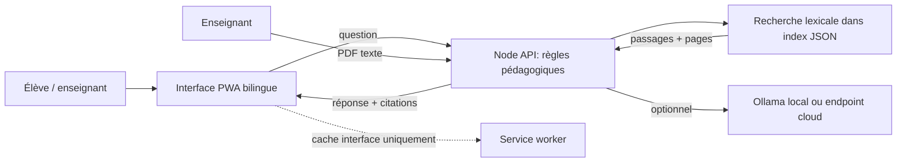

# Umuseke — tuteur IA ancré pour le secondaire rwandais

Prototype web mobile-first et installable (PWA), accompagné d'une API Node native. Le périmètre de démonstration est **Mathématiques, Senior 2 (S2)**, avec réponses appuyées sur les passages des documents chargés et leurs pages.

> **État honnête du livrable.** Le dossier initial contenait le brief et un document de conception, mais aucun manuel REB ni code. L'API, l'interface et les outils d'évaluation de ce dépôt sont un prototype créé pour ce défi. Les données d'évaluation comportent des questions de démonstration et ne sont pas des résultats d'essais. Aucun essai avec des élèves/enseignants, déploiement public, validation de kinyarwanda par locuteur natif, compte GitHub/Hugging Face, ni autorisation de droits des manuels n'est attesté. Ne présentez pas ces points comme accomplis.

## Fonctionnalités présentes

- PWA web responsive avec navigation Étude / Bibliothèque / Progression / état de préparation au pilote, interface anglais/kinyarwanda, lecteur de passages par page et import de PDF autorisés.
- Vue de préparation qui sépare prototype, preuves encore à recueillir (3 personnes, 2 enseignants, langues, red team, modèles) et garde-fous non implémentés.
- API Node native : ingestion PDF texte via `pdftotext`, page par page, recherche lexicale, réponse extraite et citations; refus si aucun passage ne correspond.
- Bibliothèque structurée de dix chapitres sous `data/documents/mathematics/s2/`, avec index JSON, formules CSV, équations, exemples et tableaux. Le contenu de démonstration est explicitement marqué **NOT REB**; aucun document officiel rwandais n'est fourni dans ce dépôt. Les exemples de contexte rwandais sous `data/documents/rwanda/` sont illustratifs, pas des données gouvernementales.
- Fournisseur de génération configurable via un endpoint OpenAI-compatible, incluant Ollama local; sans fournisseur, chemin extractif qui ne prétend pas avoir résolu l'exercice.
- Hors ligne : shell et ressources de l'application en cache. Les réponses du tuteur demandent le réseau; le modèle embarqué et l'indexation dans SQLite ne sont pas implémentés.
- Comptes locaux par pseudonyme : inscription élève, connexion/déconnexion, rôle enseignant protégé par code d'invitation, et création d'un administrateur depuis le terminal. Les mots de passe sont hachés avec scrypt; les sessions expirent après huit heures et sont conservées en mémoire.
- L'import PDF est réservé côté API aux rôles enseignant et administrateur. Assessment reste bloqué : l'authentification seule ne fournit pas encore l'affectation ni le contrôle d'une évaluation par un enseignant.
- Envoi du PDF limité à 25 Mo. Les scans sans couche texte sont détectés implicitement comme pages sans extraction; aucun OCR n'est intégré.

## Démarrage local (environ 5 minutes)

Prérequis : Node.js 20+ et `pdftotext` (Poppler; nécessaire pour extraire les PDF).

La liste complète des dépendances actuelles et futures est dans [DEPENDENCIES.md](DEPENDENCIES.md).

```bash
npm start
```

Ou lance directement `./start.sh`. Le serveur démarre sur le port 8000 par défaut; change-le avec `PORT=8080 ./start.sh` si nécessaire.

Ouvrir [http://127.0.0.1:8000](http://127.0.0.1:8000). Aucun modèle n'est requis pour démarrer. Une fois un PDF textuel chargé dans Bibliothèque, l'API répond à partir des passages retrouvés. Le contenu initial explique le flux; il n'affiche pas de réponses de démonstration qui pourraient être confondues avec le manuel.

### Qwen ou Llama (facultatif)

Installer Ollama, télécharger une fois `qwen3:4b` avec `ollama pull qwen3:4b`, démarrer Ollama, puis lancer `./start-qwen.sh`. Le modèle peut être remplacé, par exemple par `LLM_MODEL=llama3.2:1b ./start-qwen.sh`. Voir [AI_MODEL_SETUP.md](AI_MODEL_SETUP.md). Aucun gros modèle n'est téléchargé automatiquement.

### Partager et installer

- Pour partager le code, transmettre le dossier du projet (sans les PDF d'élèves ni les secrets). La personne installe Node.js 20+, puis lance `npm start` ou `./start-8080.sh`.
- Pour une exécution reproductible avec Docker : `docker build -t umuseke .` puis `docker run --name umuseke --rm -p 127.0.0.1:8080:8080 -v umuseke-data:/var/lib/umuseke -e UMUSEKE_TEACHER_SIGNUP_CODE="$UMUSEKE_TEACHER_SIGNUP_CODE" umuseke`. Ouvrir `http://localhost:8080`. Le conteneur fonctionne sans privilèges root. Le volume conserve les comptes, les PDF chargés et leur index. Le port est lié à localhost; ne le remplacez pas par une exposition publique HTTP.
- Sur `localhost`, Chrome/Edge permettent d'installer la PWA depuis le bouton « Install app ». Une installation à distance exige une adresse HTTPS et un hébergement accessible; le dossier local ne crée pas à lui seul un lien public. Pour un accès Internet, placez le conteneur derrière un reverse proxy maintenu qui fournit TLS, limite l'accès réseau et applique des sauvegardes. Ne transmettez jamais `LLM_API_KEY` au navigateur.
- Les imports PDF et index générés sont locaux au dossier `data/`; sauvegarder ce dossier si ces documents doivent être conservés. Les documents de démonstration sont déjà inclus.

#### Démo gratuite sur Render

Le fichier `render.yaml` configure un Web Service Docker gratuit avec contrôle de santé. Pour le lancer, placez ce projet dans un dépôt GitHub privé ou public auquel votre compte Render a accès, puis dans Render choisissez **New → Blueprint**, connectez ce dépôt et appliquez le Blueprint. Render construit l'image avec le Dockerfile et fournit une URL HTTPS. Voir la [référence officielle des Blueprints](https://render.com/docs/blueprint-spec) et la [référence Docker](https://render.com/docs/docker).

L'offre gratuite est uniquement destinée à une démonstration : le service peut se mettre en veille et son système de fichiers n'est pas persistant. Les comptes, sessions et PDF importés peuvent disparaître lors d'un redémarrage ou redéploiement. Aucun modèle IA n'est configuré par défaut. N'y saisissez ni données d'élèves ni documents confidentiels. Pour conserver les données, il faut un stockage persistant, généralement payant; consultez les [limites officielles des services gratuits](https://render.com/docs/free).

Ce dossier de travail n'est actuellement relié à aucun dépôt Git distant et aucun compte Render n'est connecté dans l'environnement de développement. Le Blueprint prépare le service, mais le lancement réel nécessite d'abord un dépôt Git auquel vous avez autorisé l'accès dans Render.

### Modèle local ou cloud

Définir les variables d'environnement avant le démarrage. Exemple Ollama exposant l'API compatible OpenAI :

```bash
LLM_BASE_URL=http://localhost:11434/v1 LLM_MODEL=qwen3:4b npm start
```

Pour un endpoint cloud compatible, définir aussi `LLM_API_KEY` et suivre les conditions du fournisseur. Garder les clés côté serveur, jamais dans le navigateur. Le fournisseur reçoit les passages et questions; ne pas envoyer de données personnelles d'élèves.

## Architecture



**Limites d'architecture à traiter avant un pilote :** index lexical simple (pas d'embeddings/BM25), comptes conservés dans un fichier JSON local et sessions perdues au redémarrage, aucun journal d'audit ni réinitialisation de mot de passe, pas d'OCR ni extraction fiable des tableaux/équations depuis les PDF importés, et cache hors ligne limité à l'interface. L'authentification locale n'est pas un audit de sécurité ni une autorisation de pilote avec mineurs. Voir `docs/architecture.md` et `docs/known_limitations.md`.

## Évaluation

Les matériaux sont dans `eval/`. Une commande de validation des fichiers de jeu est disponible :

```bash
python -m eval.validate
```

Elle vérifie le format et les comptes, pas la qualité pédagogique, l'exactitude des pages, la traduction ou l'efficacité des garde-fous. Les mesures de modèles/enseignants restent à recueillir réellement; ne renseigner aucun résultat inventé. Protocole: `docs/evaluation_protocol.md`.

## Livrables du défi

| Exigence | Artefact | État |
|---|---|---|
| Plan et cas d'usage | `docs/workplan.md` | Préparé, à confirmer avec les manuels REB |
| Risques mineurs | `docs/risk_register.md` | Préparé, à valider avec école/parents |
| Extraction + métadonnées | `server.mjs`, index dans `data/` | Prototype PDF texte; pas les trois sources du défi |
| RAG ancré + pages/refus | `server.mjs` | Recherche lexicale prototype, à calibrer |
| Consigne et séquence difficile | `docs/tutor_prompt.md` | Rédigées; kinyarwanda à relire |
| Site web mobile | `web/` | Prototype local |
| Tests utilisateurs (3) | `docs/user_test_protocol.md` | Protocole seulement, séances à organiser |
| Modèle cloud + modèle ouvert local | `server.mjs`, README | Interface configurable; non mesurés |
| 30 Q, 20 bilingues, grille | `eval/` | Échantillon à mapper sur le manuel REB |
| Comparaison de 3 modèles | `docs/evaluation_protocol.md` | Protocole, aucun résultat mesuré |
| 25 invites adverses | `eval/red_team.jsonl` | Cas rédigés, exécutions à faire |
| 2 enseignants + concordance | `docs/evaluation_protocol.md` | Protocole, séance non réalisée |
| Coût/latence pour 10 000 élèves | `docs/cost_and_latency.md` | Estimation hypothétique explicite |
| App mobile et hors ligne | PWA `web/` | Installable; pas appli native ni LLM hors ligne |
| Dépôt et déploiement | fichiers présents | Local; aucun dépôt distant/déploiement |
| Démo 7 min / note pilote | `docs/demo_and_recommendation.md` | Script et recommandation conditionnelle |

## Documents d'origine

Le brief source est `[FR]Challenge for education_ AI in Rwandan education system for secondary school learners.docx.pdf`; le cadrage initial, `Tuteur IA pour le secondaire rwandais — Solution au défi.docx`. Aucun de ces fichiers ne fournit les trois manuels du corpus demandé.


## Espace académique du tableau de bord

L'espace enseignant rassemble la couverture actuelle de la bibliothèque (10 leçons de mathématiques, 3 de sciences et 3 contextes rwandais), une séquence de pratique guidée, les quatre critères de la grille d'évaluation et une liste des preuves à recueillir avant un pilote. Les unités présentées sont des contenus de démonstration; elles ne constituent pas une cartographie validée du programme REB. La grille est un outil préparé, pas un score de performance. Les séances avec trois utilisateurs, la revue par deux enseignants, la validation linguistique et la comparaison de modèles restent à réaliser et à documenter.

## Comptes et rôles locaux

Les apprenants s'inscrivent avec un pseudonyme (3–24 lettres/chiffres/`_`/`-`) et un mot de passe unique d'au moins 12 caractères. L'inscription publique crée uniquement un compte élève. Pour autoriser l'inscription enseignant, définir un code secret avant le démarrage :

```bash
export UMUSEKE_TEACHER_SIGNUP_CODE='remplacer-par-un-secret-long'
npm start
```

Créer le compte administrateur depuis un terminal interactif (mot de passe masqué) avant le démarrage, ou après avoir arrêté le serveur : `npm run create-admin`. Pour Docker, créer le compte dans le volume avant de démarrer le site : `docker run --rm -it -v umuseke-data:/var/lib/umuseke umuseke npm run create-admin`. Le fichier `data/users.json` (ou `AUTH_DATA_DIR/users.json`) contient les empreintes et sels, est exclu de Git et doit être sauvegardé/protégé comme donnée privée. Les sessions sont en mémoire et prennent fin au redémarrage. Aucun nom réel ou nom d'école n'est demandé. Pour un pilote avec mineurs, faire évaluer le système et les procédures par l'établissement avant usage.

### Sécurité et limites de déploiement

Les en-têtes de sécurité, contrôles d'origine, restrictions de taille/durée des imports PDF et limites de fréquence constituent des protections de prototype, pas une certification. Les limites de fréquence utilisent l'adresse réseau vue par Node : derrière un reverse proxy, elles peuvent s'appliquer à tous les utilisateurs partageant cette adresse. Le serveur n'a pas de base de données multi-instance, de récupération de mot de passe, d'authentification multifacteur, de journal d'audit ni de sauvegardes automatiques. Les sessions sont perdues au redémarrage. Le tuteur reste accessible sans compte, avec une limite réseau simple.

Les documents chargés et leurs passages sont accessibles aux utilisateurs de l'application par la bibliothèque et l'API. N'y chargez aucun document confidentiel, dossier élève, ni manuel protégé sans autorisation de diffusion. Si un fournisseur de modèle externe est configuré, les questions et passages sélectionnés lui sont transmis; utilisez Ollama local ou désactivez le fournisseur si ces données ne doivent pas quitter le serveur. Avant un usage réel avec des mineurs, faites réaliser une revue indépendante, définissez consentement, rétention, sauvegardes et procédure d'incident avec l'établissement, puis déployez uniquement derrière HTTPS et des limites réseau adaptées.

Voir le rapport détaillé [docs/security_review.md](docs/security_review.md).
